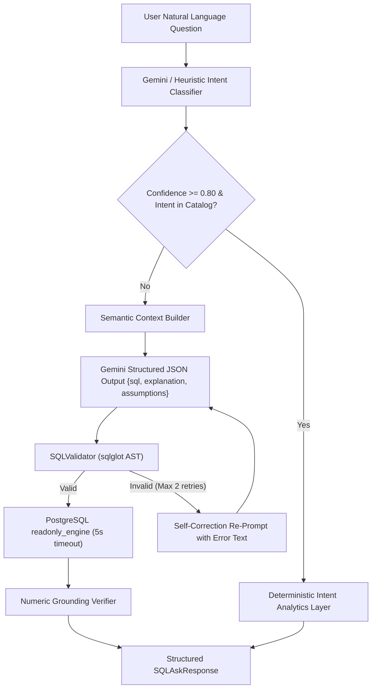

# InsightForge Guarded Text-to-SQL Architecture

## 1. Overview
InsightForge Level 3 introduces a **Guarded Text-to-SQL Engine** deployed alongside the deterministic intent router. It enables ad-hoc natural language querying across arbitrary slices, filters, comparisons, and aggregations of the Brazilian e-commerce dataset without sacrificing database security or semantic correctness.

> [!IMPORTANT]
> The LLM never receives database credentials and cannot execute arbitrary SQL. All queries are parsed into Abstract Syntax Trees (ASTs), strictly validated, sanitized, and executed solely through a read-only PostgreSQL role (`insightforge_ro`) with an enforced 5-second execution timeout.

---

## 2. Dual Routing Policy
When a natural language question is submitted via `POST /api/ai/sql-ask`:
1. **High-Confidence Intent Routing ($\text{confidence} \ge 0.80$)**:
   - If the intent classifier identifies a pre-defined canonical domain (e.g., category analysis, delivery SLA, executive KPIs), the query is routed to the deterministic analytics layer.
   - Guaranteed $O(1)$ response time, canonical consistency, and zero hallucination risk.
2. **Guarded Text-to-SQL Routing ($\text{confidence} < 0.80$ or custom filters)**:
   - For ad-hoc multi-condition questions (e.g. *"Total revenue from delivered orders in RJ in 2017"* or *"Cities in PR with highest delivered volume"*), the request is routed to the Text-to-SQL generation and validation pipeline.

---

## 3. Semantic Context Builder
The prompt context provided to Gemini is dynamically built from `/semantic`:
- **Allowed Relational Tables & Views**: Explicit schema of 7 core tables (`orders`, `order_items`, `customers`, `products`, `sellers`, `order_payments`, `order_reviews`) and 6 canonical analytical views.
- **Metric Definitions & Formulas**: Imported from `semantic/metrics.yaml`.
- **Glossary & Synonyms**: Imported from `semantic/business_glossary.yaml`.
- **Delivered Orders Rule**: Financial metrics must only count `order_status = 'delivered'`.
- **Fan-Out Prevention Rule**: Prohibits direct joins between `order_items` and `order_reviews` or `order_payments` when aggregating revenue.

---

## 4. AST Security Validation Rules (`SQLValidator`)

The validator uses `sqlglot` to parse the query into an AST and enforces the following non-negotiable security rules:

| Security Rule | Description | AST Validation Mechanism |
|---|---|---|
| **Single Statement Only** | Blocks SQL injection via stacked queries (e.g. `; DROP TABLE orders;`) | `len(sqlglot.parse(sql)) == 1` |
| **SELECT Queries Only** | Forbids all DDL and DML operations | Top-level node must be `exp.Select` or `exp.Union`; rejects `exp.Insert`, `exp.Update`, `exp.Delete`, `exp.Drop`, `exp.Create`, `exp.Alter`, `exp.TruncateTable` |
| **System Commands Denylist** | Rejects administrative and procedural statements | Blocks `exp.Set`, `exp.Command`, `exp.Copy` |
| **System Schema Denylist** | Prevents probing database internals | Rejects any table or column reference to `pg_catalog`, `information_schema`, `pg_toast`, `pg_temp` |
| **Table Allow-List** | Prevents accessing unauthorized or internal tables | Only approved tables and analytical views are allowed. Explicitly rejects `ai_audit_log` |
| **Function Denylist** | Blocks dangerous or arbitrary execution functions | Denies `pg_sleep`, `pg_read_file`, `pg_ls_dir`, `dblink`, `set_config`, `current_setting`, and all large-object `lo_*` functions |
| **Cross-Join Prohibition** | Prevents server denial-of-service from Cartesian explosions | Rejects `CROSS JOIN` and comma-separated `FROM a, b` without join conditions |
| **Fan-Out Join Guardrail** | Prevents cartesian multiplication of revenue figures | Rejects queries joining `order_items` with `order_reviews` or `order_payments` when summing prices or revenue |
| **Forced Limit Clamping** | Caps maximum returned rows at 500 | Injects `LIMIT 500` if missing; clamps any requested limit $> 500$ to $500$ |
| **Comment Neutralization** | Prevents comment-based bypass tricks | Strips all `/* */` and `--` comments on AST walk and regenerates sanitized Postgres SQL |

---

## 5. Self-Correction Loop
If the generated SQL fails AST validation or PostgreSQL raises an execution error:
1. The error message and the failed SQL query are fed back into Gemini.
2. Gemini is prompted to fix the identified issue (e.g., removing a denied function, replacing an unlisted table with an allowed view, or resolving a syntax error).
3. The engine allows up to **2 self-correction retries** (3 total attempts).
4. If the query remains invalid after 2 retries, the service returns a polite failure response without executing anything against the database.

---

## 6. Frontend UI Capabilities
The user interface (`/ask`) supports:
- **Route Indicator**: Badges showing whether the question was answered via the Deterministic Intent Router or Guarded Text-to-SQL.
- **Show SQL Panel**: Code viewer displaying the sanitized, executed SQL query.
- **Dynamic Result Table**: Responsive tabular display of all returned rows formatted with Brazilian Real (`R$`) currency formatting.
- **Chart Suggestion**: Automatic preview of Bar Charts or Line Charts using Recharts when results are categorical or time-based.
- **ErrorBanner**: Transparent 503 error banner when the database is unavailable.
