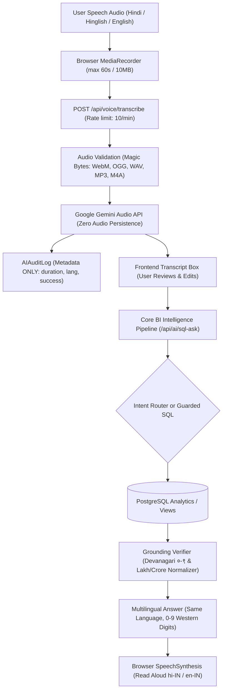

# InsightForge — Voice Input & Multilingual Business Intelligence (Level 4)

## Overview
InsightForge Level 4 introduces end-to-end voice transcription and native multilingual understanding for **English**, **Hindi (हिन्दी in Devanagari script)**, and **Hinglish (Hindi in Roman/Latin script)**. 

Voice input serves as an accessible input modality that converts speech to clean text. Once transcribed, queries flow through the exact same deterministic, secure, and grounded enterprise intelligence pipeline (Intent Router, Guarded Text-to-SQL, and Grounding Verifier).

---

## 1. Architecture & Execution Flow



---

## 2. Audio Processing & Privacy Policy

### Strict Zero-Persistence Guarantee
- **No Disk Storage**: Audio files are read directly into in-memory bytes and streamed to Google Gemini. They are **never** written to local disk, temporary files, or file caches.
- **No Database Audio Storage**: PostgreSQL stores **no** audio blobs.
- **Metadata-Only Audit Logging**: Interactions logged to `ai_audit_log` contain only operational metadata:
  ```json
  {
    "question": "[voice_transcribe: hi, est_dur: 2.4s, size: 38400B]",
    "intent": "voice_transcribe_hi",
    "latency_ms": 320.5,
    "success": true
  }
  ```
- **Privacy Notice**: Rendered transparently to users in the UI:
  > *"Audio is sent to Google Gemini for transcription and is not stored."*

### Audio Validation & Limits
| Parameter | Enforcement Limit | Failure Code |
| :--- | :--- | :--- |
| **Max Payload Size** | 10 MB (10,485,760 bytes) | `HTTP 413 Payload Too Large` |
| **Max Duration** | 60 seconds (browser timer & auto-stop) | Enforced on frontend & capped |
| **Supported Formats** | WebM (`audio/webm`), OGG (`audio/ogg`), WAV (`audio/wav`), MP3 (`audio/mpeg`), M4A (`audio/mp4`) | `HTTP 415 Unsupported Media Type` |
| **Empty Payload** | 0 bytes | `HTTP 400 Bad Request` |
| **Rate Limiter** | 10 requests / minute per IP | `HTTP 429 Too Many Requests` |
| **Missing API Key** | `GEMINI_API_KEY` unset | `HTTP 503 Service Unavailable` |

---

## 3. Multilingual Understanding & Synthesis

### Language Support Matrix
| Language | Script / Notation | Example Question | Example Answer |
| :--- | :--- | :--- | :--- |
| **Hindi** | Devanagari (`hi`) | *"सबसे ज्यादा बिक्री किस श्रेणी में हुई?"* | *"PostgreSQL एनालिटिक्स के अनुसार, सबसे अधिक राजस्व **Health & Beauty** श्रेणी से **R$ 1,233,131.72** प्राप्त हुआ।"* |
| **Hinglish** | Roman / Latin (`hinglish`) | *"sabse zyada bikri kis category mein hui?"* | *"PostgreSQL analytics ke mutabiq, sabse zyada revenue **Health & Beauty** category se **R$ 1,233,131.72** raha."* |
| **English** | Standard English (`en`) | *"Which category generated the highest revenue?"* | *"Based on PostgreSQL analytics, the product category generating highest revenue is **Health & Beauty** with **R$ 1,233,131.72**."* |

### Critical Number Formatting Rule
To guarantee complete arithmetic fidelity and prevent numeric hallucinations in South Asian scripts:
- In **every language** (including Hindi and Hinglish), the AI is strictly instructed to write all numbers, values, and quantities using standard **Western digits `0-9`**.
- Monetary amounts are strictly formatted with the Brazilian Real currency symbol **`R$`** (e.g., `R$ 15,419,773.75`).
- The model is forbidden from spelling out numbers as words or writing Devanagari numerals (`०-९`).

---

## 4. Grounding Verifier Multilingual Extensions

To maintain 100% numeric faithfulness on Hindi and Hinglish questions, `backend/app/services/grounding.py` incorporates two pre-processing normalization passes:

1. **Devanagari Numeral Normalization**:
   Translates Devanagari digits `०, १, २, ३, ४, ५, ६, ७, ८, ९` into standard ASCII Arabic digits `0, 1, 2, 3, 4, 5, 6, 7, 8, 9`.
2. **Indian Scale Word Normalization**:
   Expands scale words common in Hindi/Hinglish:
   - `3.5 lakh` / `३.५ लाख` $\rightarrow$ `350000.00`
   - `1.54 crore` / `१.५४ करोड़` $\rightarrow$ `15400000.00`
   - `50 hazaar` / `५० हज़ार` $\rightarrow$ `50000.00`
3. **Indian Comma Notation Support**:
   Regex pattern `NUMBER_REGEX` parses both Western thousands separation (`1,233,131.72`) and Indian grouping (`12,33,131.72`).

---

## 5. Frontend Voice & Audio Controls

- **Mic Button**: Features clean visual states (idle with microphone icon vs. red pulsing active recording button).
- **Recording Timer**: Live countdown display (`00:14 / 01:00`) that automatically stops recording after 60 seconds.
- **Editable Transcript Box**: Speech transcripts populate the question input box so the user can inspect, correct, and edit the query before submitting. Queries are **never auto-sent**.
- **Browser Fallback**: If backend voice transcription is unreachable or unconfigured, the frontend automatically falls back to browser `SpeechRecognition` (`hi-IN` / `en-IN`).
- **Text-to-Speech (Read Aloud)**:
  - Uses browser `window.speechSynthesis`.
  - Automatically queries available system voices for `hi-IN` (Hindi) or `en-IN`/`en-US` (English).
  - If no native Hindi voice is installed on the user's operating system, shows an informative inline alert rather than failing silently:
    > *"No native Hindi voice installed on this system; playing using default system voice."*
- **Typography**: Includes Google's `Noto Sans Devanagari` font for crisp, native rendering of Hindi text.
